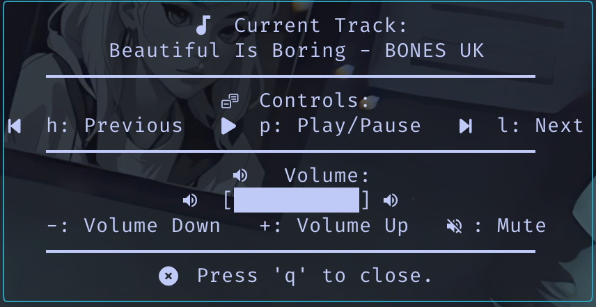
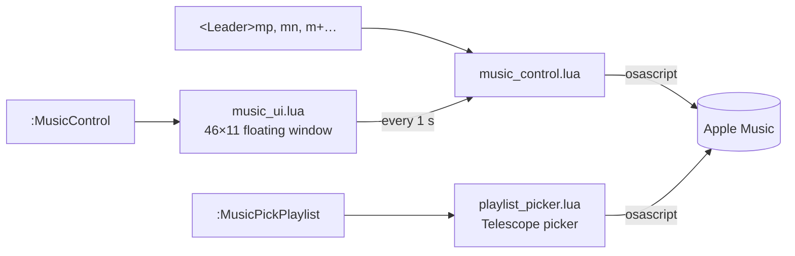

<div align="center">

<h1>Zarya.nvim</h1>

<p><strong>Control Apple Music without leaving Neovim.</strong></p>

<p>
  
  
  
  <a href="LICENSE"></a>
</p>

<p>
  <a href="#why">Why</a> ·
  <a href="#how-it-works">How it works</a> ·
  <a href="#installation">Installation</a> ·
  <a href="#usage">Usage</a> ·
  <a href="#limitations">Limitations</a>
</p>

</div>

Control Apple Music from Neovim. Zarya opens a floating window with the current track and
playback controls, and includes a Telescope picker for playlists.



## Why

Switching to the Music app to skip a track or change a playlist breaks focus. Zarya puts the
few controls you actually use behind leader mappings, and shows what is playing in a small
window that stays out of the way of your code.

## How it works

Apple Music on macOS is scriptable through AppleScript. Zarya doesn't link to any library: each
action shells out to `osascript` with a one-line `tell application "Music"` command.



| Action | AppleScript sent to Music |
| --- | --- |
| Current track | `get name of current track & " - " & artist of current track` |
| Play / pause | `playpause` |
| Next / previous | `next track` / `previous track` |
| Volume | `set sound volume to (sound volume ± 10)` |
| Playlists | `get name of every playlist`, then play the one you pick (optionally shuffled) |

- The **floating window** is anchored to the top-right of the editor with a rounded border, and
  doesn't take focus, so you keep typing. While it is open, it re-queries the current track
  every second.
- The **playlist picker** lists every playlist through Telescope. On selection, it asks whether
  to shuffle, then starts playback.

## Requirements

- macOS (Zarya drives Apple Music through `osascript`)
- Neovim 0.7 or later
- [telescope.nvim](https://github.com/nvim-telescope/telescope.nvim)
- [plenary.nvim](https://github.com/nvim-lua/plenary.nvim)

## Installation

With [lazy.nvim](https://github.com/folke/lazy.nvim):

```lua
{
  "NoamFav/Zarya.nvim",
  dependencies = {
    "nvim-telescope/telescope.nvim",
    "nvim-lua/plenary.nvim",
  },
}
```

With [packer.nvim](https://github.com/wbthomason/packer.nvim):

```lua
use {
  "NoamFav/Zarya.nvim",
  requires = { "nvim-telescope/telescope.nvim", "nvim-lua/plenary.nvim" },
}
```

No `setup()` call is needed. The plugin registers its commands and key mappings when it
loads.

## Usage

| Command | Description |
| --- | --- |
| `:MusicControl` | Open the floating music UI |
| `:FocusMusicUI` | Move focus to or from the music UI |
| `:MusicPickPlaylist` | Pick a playlist with Telescope (asks whether to shuffle) |

| Mapping | Action |
| --- | --- |
| `<Leader>mu` | Open the music UI |
| `<Leader>mp` | Play or pause |
| `<Leader>mn` | Next track |
| `<Leader>mb` | Previous track |
| `<Leader>m+` / `<Leader>m-` | Volume up or down |
| `<Leader>mm` | Focus the music UI |
| `<Leader>mq` | Close the music UI |
| `<Leader>pp` | Pick a playlist |

The track display refreshes every second while the UI is open.

## Limitations

- macOS only: it depends on `osascript` and the Music app.
- Each action starts an `osascript` process, which takes a few tens of milliseconds, so the UI
  refresh is a polling loop rather than an event subscription.
- The mappings are set unconditionally when the plugin loads; there is no `setup()` to change
  or disable them yet. Override them in your config after the plugin loads if they clash.

## Contributing

See [CONTRIBUTING.md](CONTRIBUTING.md) and the [Code of Conduct](CODE_OF_CONDUCT.md).

## License

Licensed under the [Apache License 2.0](LICENSE). See [NOTICE](NOTICE) for copyright
and attribution notices.
